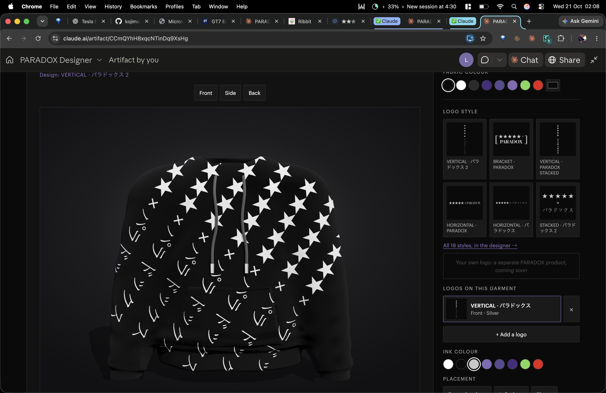

# ★★★★★ × PARADOX Designer — version 1

**The concept: the customer designs, PARADOX produces.** Choose a garment and a colour, compose it from the official PARADOX marks on a realistic 3D garment, save it, share it and send it to print.

Version 1, frozen 21 October 2026. The example design above is **DIAGONAL · パラドックス** in silver on a black hoodie. It's the example for spec and promo material, and now the 19th official variation.

## Run it

Open `index.html` in a browser. There's no build step: three.js loads from jsDelivr. Saving, sharing and orders use the hosted version's database; opened locally, designs save in the browser.

## What's in it

| File | What it does |
|---|---|
| `index.html` | The Designer page: garment, rail, specification, order |
| `app.js` | The garment engine (a signed-distance cloth body meshed at load, baked occlusion, cast shadows, a knit surface, the slow turntable) and the studio logic |
| `logo-designer.js` | The Logo Designer: logo-experiments rebuilt as a standalone, reusable module (`PXLogoDesigner.open`) |
| `logos.js` | The 18 official marks from logo-experiments, untouched |
| `logos-extra.js` | Variations born in the Designer, added to the set: DIAGONAL · パラドックス |
| `docs/CONCEPT.md` | The concept: principles, journey, marks, production spec, roadmap |

Pricing ends in 5, for the five stars: T-shirt £55 · Long sleeve £75 · Hoodie £95.

---

★★★★★ × PARADOX™ is a trademark of PARADOXICA Ltd., a company registered in England and Wales, company no. 17145296.
